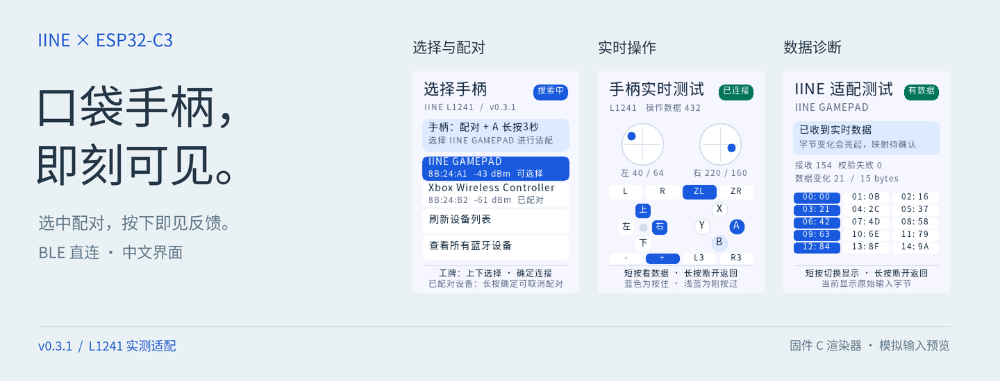
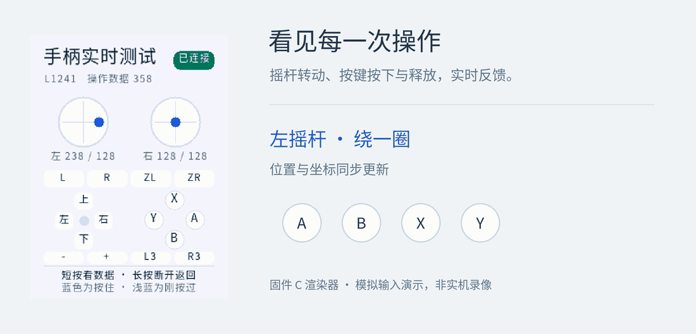

<div align="center">

[](CHANGELOG.md)
[](https://docs.espressif.com/projects/esp-idf/en/v5.5.3/esp32c3/get-started/index.html)
[](https://github.com/1ikeMcFlurry/esp32c3-iine-gamepad/actions/workflows/ci.yml)
[](LICENSE)

**[快速上手](#快速上手)　 /　 [硬件接线](docs/HARDWARE.md)　 /　 [使用指南](docs/USAGE.md)　 /　 [协议解析](docs/PROTOCOL.md)**

</div>

## 把工牌变成手柄测试台

用 **ESP32-C3 直接连接良值口袋手柄 Pro L1241**。从屏幕选中设备，完成配对，转动摇杆、按下按钮，操作就会出现在中文彩屏上。无需手机或电脑转发。

- **选得到：** 扫描附近设备，查看信号和配对状态，用工牌实体键选择连接。
- **看得见：** 双摇杆、十字键与 12 个按键实时反馈，短按还有浅蓝色提示。
- **查得清：** 一键切到原始数据页，查看输入字节、变化高亮与接收计数。

## 按下，就有回应



<div align="center">
<sub>动图由固件同一套 C 渲染器生成，输入为模拟数据。实际 L1241 的显示与重连已完成现场验收。</sub><br>
<sub><a href="docs/assets/input-demo-still.png">查看静态图</a> · <a href="docs/ui-preview.png">浏览全部 8 种界面</a></sub>
</div>

## 快速上手

准备 **8 MB ESP32-C3 工牌、ST7789P3 240 × 320 屏幕、ADC 三键及 L1241**。其他开发板请先核对 [引脚与分区](docs/HARDWARE.md)，工具链使用 [ESP-IDF v5.5.3](https://docs.espressif.com/projects/esp-idf/en/v5.5.3/esp32c3/get-started/index.html)。

### ① 编译

在已经激活 ESP-IDF 的终端中运行：

```sh
git clone https://github.com/1ikeMcFlurry/esp32c3-iine-gamepad.git
cd esp32c3-iine-gamepad
idf.py set-target esp32c3
idf.py build
```

### ② 烧录

已有兼容 bootloader 和分区表的设备，仅更新应用；将 `COM3` 替换为实际串口：

```sh
idf.py -p COM3 app-flash monitor
```

> [!IMPORTANT]
> 先核对 [应用地址与分区要求](docs/HARDWARE.md#烧录与分区)。已有身份数据、ROM 或存档的设备不要执行 `erase-flash`。空白板的完整烧录方式见硬件文档。

### ③ 配对，开始操作

**手柄长按「配对键 + A」约 3 秒 → 工牌选择 `IINE GAMEPAD` → 短按确定。**

进入实时测试页后，转动摇杆或按下按钮即可。映射已写进固件，**重启和重连都不用重新映射**。

| 工牌操作 | 功能 |
| :--- | :--- |
| 上 / 下键 | 在列表选择设备 |
| 短按确定 | 连接设备；连接后切换图形 / 数据页 |
| 长按确定约 0.9 秒 | 取消或断开，返回设备列表 |

配对管理、历史设备重连和其他操作见 [使用指南](docs/USAGE.md)。

## 已经验证到哪里？

| 实测支持 | 需要另外验证 |
| :--- | :--- |
| L1241，私有身份 `0710 / 0220 / 27.02` | 其他 IINE 型号或固件版本 |
| 双摇杆、十字键、12 按键、组合与释放 | Home、截图、Turbo、震动、陀螺仪 |
| 8 MB ESP32-C3 工牌，显示与断开重连 | 其他板卡的接线、电路和分区 |

L1241 使用实测的 **IINE 私有 BLE 输入通道**。项目还提供通用 BLE HID 描述符解析，但兼容性需逐设备验证。未知身份保留原始诊断，不套用已测映射。

## 想继续折腾？

**358 条实机输入回放**、**20,000 个随机 HID 描述符**、**ASan / UBSan 边界检查**，加上 GitHub Actions 的固件构建，让每次修改都有验证依据。

```sh
# Linux / WSL：运行解析器与界面测试
python3 tools/test_host.py
```

| 从这里开始 | 你会找到 |
| :--- | :--- |
| [硬件与烧录](docs/HARDWARE.md) | 屏幕引脚、ADC 按键、应用地址、分区与移植 |
| [使用指南](docs/USAGE.md) | 配对与重连、界面状态、常见问题 |
| [私有协议](docs/PROTOCOL.md) | BLE 服务、握手、帧格式、L1241 输入布局 |
| [开发与验证](docs/DEVELOPMENT.md) | 工具链、测试、预览生成、串口与故障排查 |
| [版本记录](CHANGELOG.md) | 从 BLE 连接到屏幕显示的迭代记录 |

---

<div align="center">

**让每一次按下，都有看得见的回应。**

[MIT License](LICENSE) · [字体与第三方许可](THIRD_PARTY_NOTICES.md) · [反馈问题](https://github.com/1ikeMcFlurry/esp32c3-iine-gamepad/issues)

<sub>感谢 ESP-IDF / NimBLE、<a href="https://iine.store/pages/pocket-controller-ns-guide-manual">IINE 官方指南</a>与 <a href="https://github.com/AmjadAAYD/x20ctl/blob/553ad76f89d19706a1bd0e45d8aab6f2c14ed231/docs/01-protocol.md">x20ctl 协议研究</a>。社区项目，非 IINE 或 Espressif 官方产品。</sub>

</div>
