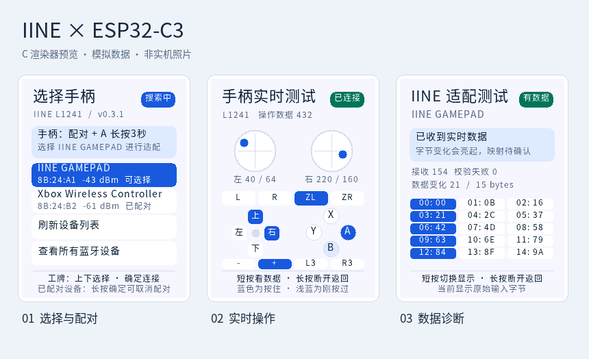
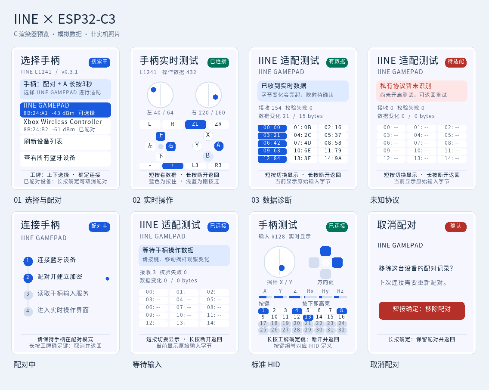
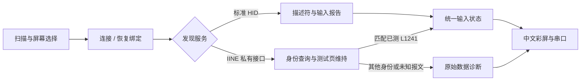

<div align="center">

# IINE × ESP32-C3

**让口袋手柄的每一次操作，都看得见。**

良值口袋手柄 Pro L1241 · BLE 直连 · 中文彩屏 · 设备选择与配对

[](CHANGELOG.md)
[](https://docs.espressif.com/projects/esp-idf/en/v5.5.3/esp32c3/get-started/index.html)
[](https://github.com/1ikeMcFlurry/esp32c3-iine-gamepad/actions/workflows/ci.yml)
[](LICENSE)

[快速上手](#快速上手) · [硬件接线](docs/HARDWARE.md) · [协议说明](docs/PROTOCOL.md) · [开发与测试](docs/DEVELOPMENT.md)



<sub>由固件同一套 C 渲染器生成，使用模拟输入；不是实机照片。</sub>

</div>

## 这是一个什么项目？

一个可以在 **ESP32-C3 工牌上直接连接 IINE L1241** 的独立 ESP-IDF 固件。扫描附近的手柄，在屏幕上选择并连接，就能看到双摇杆、十字键和按键状态；遇到未知报文，还可以切换到原始数据页观察。

L1241 的已测接口没有标准 BLE HID 服务。本项目通过其 **IINE / KeyLinker 私有 BLE 测试通道**接收真实输入，不需要手机或电脑转发。另保留通用 BLE HID 描述符解析路径。

**已完成实机验收：** L1241 的按键与摇杆输入、屏幕显示、数据页切换、断开及重新连接。映射已写入固件，日常使用和重连都不需要重新逐键校准。

## 一眼了解

| 能力 | 体验 |
| :--- | :--- |
| 发现与连接 | 扫描列表、信号强度、配对标记、实体键选择 |
| 实时操作 | 双摇杆坐标、十字键、A/B/X/Y、肩键、扳机、±、L3/R3 |
| 按键反馈 | 蓝色表示按住；浅蓝色保留约 600 ms 的短按提示 |
| 数据诊断 | 原始输入、变化字节高亮、报文及校验失败计数 |
| 配对管理 | NVS 保存绑定、选择历史设备重连、取消配对 |
| 轻量显示 | 240 × 320 中文界面，7,680 字节 DMA 条带缓冲，无 LVGL |
| 可验证 | 358 条实机输入样本、解析与 UI 测试、GitHub Actions 编译 |

<details>
<summary><strong>展开查看 8 种界面状态</strong></summary>



选择设备、实时操作、原始数据、未知协议、配对中、等待输入、标准 HID、取消配对。

</details>

## 兼容范围

| 对象 | 当前状态 |
| :--- | :--- |
| IINE 口袋手柄 Pro **L1241** | 已实测；私有身份 `VID 0710 / PID 0220 / FW 27.02` |
| 其他 IINE 型号 / 固件版本 | 未验证；身份不匹配时仅显示原始数据，不套用 L1241 映射 |
| 标准 BLE HID 手柄 | 已实现通用解析并通过合成报文测试，兼容性需逐设备验证 |
| ESP32-C3 工牌 | 已实测：8 MB Flash、ST7789P3 屏幕、GPIO0 ADC 三键 |
| 其他 ESP32-C3 开发板 | 需匹配屏幕、接线、按键电路和分区；不是任意 C3 板的即插即用固件 |

Home、截图、Turbo、震动、陀螺仪和 Switch 私有握手尚未适配。此项目是手柄输入演示与诊断固件，不是 USB 游戏手柄转接器。

## 快速上手

### 1. 获取并编译

安装并激活 [ESP-IDF v5.5.3](https://docs.espressif.com/projects/esp-idf/en/v5.5.3/esp32c3/get-started/index.html)，在其终端运行：

```sh
git clone https://github.com/1ikeMcFlurry/esp32c3-iine-gamepad.git
cd esp32c3-iine-gamepad
idf.py set-target esp32c3
idf.py build
```

应用镜像：`build/iine_gamepad_demo.bin`。普通编译不需要下载字体或安装 Pillow。

### 2. 烧录

**已经有兼容 bootloader 和分区表的设备：** 先核对 [分区要求](docs/HARDWARE.md#烧录与分区)，然后只更新应用。将 `COM3` 换成实际串口；Linux 常见为 `/dev/ttyACM0`。

```sh
idf.py -p COM3 app-flash monitor
```

**空白、接线匹配的 8 MB 板：** 可完整烧录本项目的 bootloader、分区表和应用。

```sh
idf.py -p COM3 flash monitor
```

> **已有数据的工牌请使用 `app-flash`。** 本项目应用位于 `0x10000`；完整 `flash` 会替换分区表。不要对已有身份数据、ROM 或存档的设备执行 `erase-flash`。烧录脚本不会自动检查设备分区是否兼容。

按 `Ctrl+]` 退出串口监视器。Windows 还可使用 [可选构建脚本](docs/DEVELOPMENT.md#可选构建脚本)。

### 3. 配对 L1241

1. 唤醒手柄，避免其他手机或电脑抢先连接。
2. 同时长按 **配对键 + A，约 3 秒**。
3. 在工牌列表选择 **`IINE GAMEPAD`**，短按工牌确定键。
4. 等待实时测试页，按键或转动摇杆，观察高亮与坐标。

配对组合来自 [IINE 官方指南](https://iine.store/pages/pocket-controller-ns-guide-manual)。本项目实测连接的是 `IINE GAMEPAD` 私有 BLE 接口；官网列出的 Android 游戏设备名称则为 `Gamepad`。

### 4. 操作工牌

| 所在页面 | 工牌操作 | 结果 |
| :--- | :--- | :--- |
| 设备列表 | 上 / 下 | 选择手柄或底部列表选项 |
| 设备列表 | 短按确定 | 连接、刷新或切换筛选 |
| 实时测试 | 短按确定 | 图形页 ↔ 原始数据页 |
| 连接 / 实时测试 | 长按确定约 0.9 秒 | 取消或断开，返回列表 |
| 已保存设备 | 长按确定 | 打开取消配对确认页 |
| 取消配对确认页 | 短按确定 / 长按确定 | 移除配对 / 返回 |

重连时唤醒手柄，在列表选中历史设备即可。固件不自动连接附近设备。

## 它是怎样工作的？



蓝牙回调更新状态，独立显示任务刷新 LCD。私有输入是增量事件：未出现在当前报文中的按键保持原状态，组合键与各自的释放分别处理。损坏或未知记录整包拒绝，避免部分更新造成粘键。

固件只发送身份、能力查询及临时测试模式命令，不写手柄映射、宏、校准或升级数据。完整报文布局见 [协议说明](docs/PROTOCOL.md)。

## 验证与项目结构

Linux / WSL 中运行：

```sh
python3 tools/test_host.py
```

覆盖 HID 多报告与畸形描述符、20,000 个随机描述符、IINE 帧校验、358 条实机输入回放，以及界面选择、断线清零和渲染边界；使用 ASan / UBSan。GitHub Actions 另构建 ESP32-C3 应用，成功后可在运行页面下载应用镜像。

```text
main/
  gamepad_hid.c       BLE 扫描、选择、绑定与标准 HID
  iine_link.c         IINE 服务与异步握手、测试页维持
  iine_protocol.c     有界帧编解码与 L1241 增量输入解析
  hid_input.c         通用 HID 描述符解析
  gamepad_ui.c        界面状态与按键操作
  gamepad_render.c    可在主机测试的 C 绘图器
  gamepad_screen.c    ST7789 屏幕、背光与 ADC 按键
tests/               单元测试、实机输入样本、预览程序
tools/               构建辅助、串口、字体与预览生成
docs/                硬件、协议、开发说明与预览图
```

## 常见问题

**每次连接都要重新映射吗？**

不需要。已测 L1241 的映射编译在固件中，断开、重启、重连不会丢失。换型号或升级手柄后若输入协议发生变化，需要重新验证。

**为什么“已连接”却没有操作？**

检查型号、身份和配对模式，并查看数据页。配置通道连接成功不等于已经收到输入；未匹配身份不会启用 L1241 映射。可参照 [诊断表](docs/DEVELOPMENT.md#故障排查)。

**能直接刷到我的开发板吗？**

需要先核对 [硬件接线和分区](docs/HARDWARE.md)。默认参数面向已测工牌；4 MB 板或不同 LCD / 按键电路需要移植。

**如何适配另一只手柄？**

先记录型号、固件身份和服务，再捕获按下、释放、组合及摇杆端点。提交经过脱敏的 payload 与测试，增加独立身份匹配；不要仅凭同名广播复用映射。

## 许可与致谢

项目代码采用 [MIT License](LICENSE)。中文点阵子集源于 Noto Sans CJK SC，遵循 [SIL OFL 1.1](licenses/OFL-NotoSansCJK.txt)；第三方说明见 [THIRD_PARTY_NOTICES.md](THIRD_PARTY_NOTICES.md)。

感谢 [ESP-IDF / NimBLE](https://github.com/espressif/esp-idf)、[IINE 官方指南](https://iine.store/pages/pocket-controller-ns-guide-manual) 和 [x20ctl 的 KeyLinker 协议研究](https://github.com/AmjadAAYD/x20ctl/blob/553ad76f89d19706a1bd0e45d8aab6f2c14ed231/docs/01-protocol.md)。这是社区项目，与 IINE 或 Espressif 无隶属关系。
