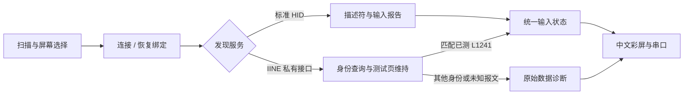

# 使用指南

[返回首页](../README.md)

## 第一次连接

1. 唤醒手柄，避免其他手机或电脑抢先连接。
2. 在 L1241 上同时长按 **配对键 + A，约 3 秒**。
3. 在工牌列表选中 **IINE GAMEPAD**，短按确定。
4. 等待实时测试页，按键或转动摇杆，观察状态。

配对组合来自 [IINE 官方指南](https://iine.store/pages/pocket-controller-ns-guide-manual)。本项目连接的是 `IINE GAMEPAD` 私有 BLE 接口；官网列出的 Android 游戏设备名为 `Gamepad`。

## 工牌按键

| 页面 | 操作 | 结果 |
| --- | --- | --- |
| 设备列表 | 上 / 下 | 选择设备或底部列表选项 |
| 设备列表 | 短按确定 | 连接、刷新或切换设备筛选 |
| 实时测试 | 短按确定 | 图形页 / 原始数据页切换 |
| 连接 / 实时测试 | 长按确定约 0.9 秒 | 取消或断开，返回列表 |
| 已保存设备 | 长按确定 | 打开取消配对确认页 |
| 取消配对确认页 | 短按确定 / 长按确定 | 移除配对 / 返回 |

重连时唤醒手柄，在列表选中历史设备。固件不会自动连接附近设备。

## 界面与颜色

- 蓝色：当前按住；浅蓝色：约 600 ms 的短按提示。实际松开状态立即更新。
- 摇杆坐标：0–255，中心 128；向右 / 向下递增。
- 数据页：输入字节、变化高亮、报文与校验失败计数。
- 未知协议或身份：显示原始数据，不猜测控件映射。
- 手柄睡眠或掉线：清除输入状态并回到列表。

图示采用模拟输入，不是实机照片或录像。已测 L1241 的输入、图形显示、数据页切换、断开重连均已完成现场验收；公开字体版的验证边界见 [开发文档](DEVELOPMENT.md#已完成验证与边界)。

## 数据流

蓝牙回调更新状态，独立显示任务刷新屏幕。IINE 输入是增量事件：未出现在报文中的按键保持原状态，组合键与各自的释放分别处理。

## 常见问题

**每次连接都要重新映射吗？**

不用。L1241 的已测布局已经编译在固件中，断开、重启和重连不会丢失。换型号或手柄升级导致协议改变时，才需要重新验证。

**为什么连接了却没反应？**

配置通道连接成功不等于已经收到输入。先确认配对模式，再查看身份及数据页计数；完整步骤见 [故障排查](DEVELOPMENT.md#故障排查)。

**可以刷到任何 ESP32-C3 吗？**

需先核对 [屏幕、按键和分区](HARDWARE.md)。当前默认配置面向 8 MB 工牌，4 MB 板或不同面板需要移植。

**能当 USB 手柄转接器吗？**

目前是输入显示与诊断 demo，没有实现 USB 游戏手柄桥接、震动或陀螺仪功能。

**怎么支持别的手柄？**

记录型号、固件身份与服务，采集按下、释放、组合及摇杆端点，增加独立的身份匹配和回归样本。仅有同名广播或相同 UUID 不足以证明输入兼容。
